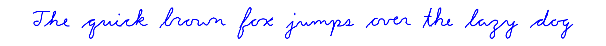
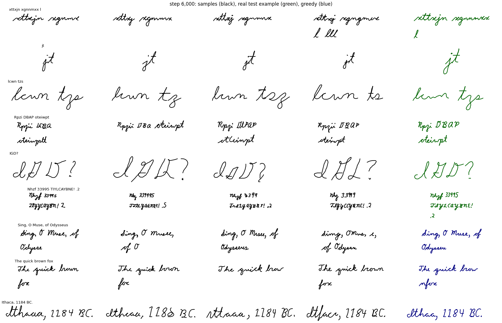
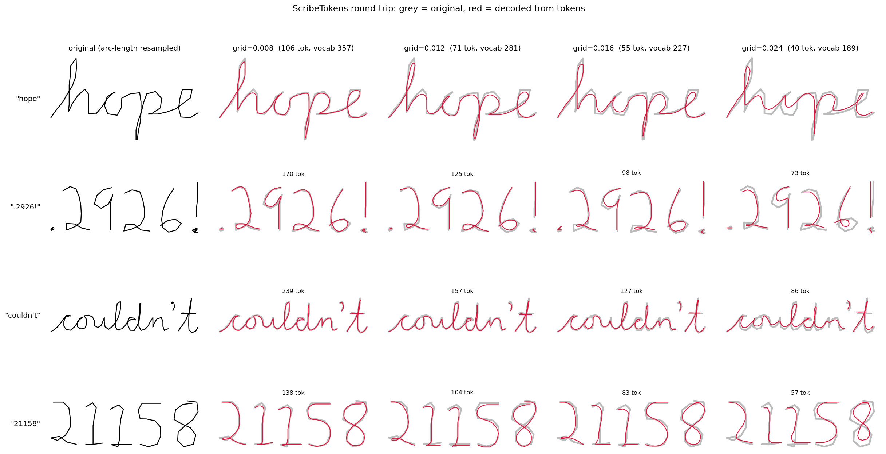
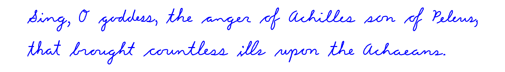

# pengpt

A small transformer that writes handwriting from text. It is a ground-up
rewrite of [cursivetransformer](https://github.com/greydanus/cursivetransformer)
([paper](https://arxiv.org/abs/2504.00051)) that trains in about 15 minutes on
an M-series laptop.



*One greedy pass from the bundled cursive model. Most of these words never
appear in the training data, which is mostly random character strings.*

## Quickstart

```bash
pip install -e ".[dev]"
pytest tests/
python pengpt.py train --preset cursive
python pengpt.py sample --checkpoint out/cursive/best.pt --greedy --text "The quick brown fox jumps over the lazy dog"
```

Each run writes to `out/<name>/`: `best.pt` (lowest test loss), `last.pt` (latest
eval; resume with `--resume out/cursive/last.pt`), and `progress/`, one image
per eval. Any flag overrides the preset. Add `--wandb` to log to Weights & Biases.

Sampling tips: `--greedy` spells unfamiliar words much better than sampling.
To regenerate misspelled words, use `--show_indices` to find their index, then
`--redo 3,7` (without `--greedy`, since greedy gives the same word again).
`--writer sam` picks a writer's style; leave it out for the unknown-writer style.



*The progress grid: real test word (green), greedy sample (blue), three samples
(black). The bottom rows are the preset's showcase phrases. Prompts and seeds
are fixed between evals.*

Each eval also logs `text rank`: 32 test examples are each scored under their
own prompt and the other 31 prompts, and the mean rank of the true prompt is
reported (1 is perfect, 16.5 is chance). This catches a model that ignores
its prompt. `python pengpt.py rank --checkpoint ...` computes it for a
saved checkpoint.

## How it works

**Tokens** ([ScribeTokens](https://arxiv.org/abs/2603.02805)). Pen points are
snapped to a grid (`--grid 0.02`). Motion becomes a walk on that grid: eight
compass directions plus `DOWN` and `UP`, with Bresenham lines filling any
gaps. BPE (`--n_merges 512`) then merges common runs into single tokens. Each
word's walk starts from its own origin, so the tokens encode where the ink
sits relative to the baseline.



On the bundled data this beat the paper's polar tokenizer on every measure:

| | tokens/word | reconstruction error | vocab |
|---|---|---|---|
| polar bins | 185 | 0.0116 | 525 |
| ScribeTokens | **99** | **0.0061** | **306** |

Trained head to head for the same wall-clock time, ScribeTokens reached 3.43
bits per pen point against 7.16 for the polar tokenizer.

**Model.** A nanochat-style decoder, about 400k parameters at the default size.
It uses rotary positions, RMSNorm, QK-norm, ReLU² MLPs, no biases, zero-init
output projections, a logit soft cap, and cross-attention over the prompt's
UTF-8 bytes. Block matrices train with Muon and everything else with AdamW.
The learning rate warms up for 200 steps, then decays linearly over the last
`--warmdown` fraction of steps (default 0.8). Generation uses a fixed-shape
key/value cache.

The model also gets Fourier features of the pen's position, summed from
per-token displacements. During training, this position gets a random offset
of up to ±`--pen_pos_jitter` grid cells, so the features carry position
within the sequence, not on the page. `--pen_pos_bands 0` turns them off.

**Batches.** Each training sequence comes from one writer. It packs a random
1 to `--max_words` words, separated by `WORD` tokens, and never cuts a word in
half. One augmentation is applied to the whole sequence: slant ±0.1, stretch
±10%, rotation ±2°, and a shift of up to half a grid cell (`--no-augment` turns
it off). Test data is never augmented.

**Writers.** Each writer gets a learned style vector that sits in front of the
prompt. 10% of the time, training swaps in a shared "unknown writer" vector.

**Long text** is written two words per model call and wrapped into lines.
Each call continues from the last word already written (`--burn_in 1`), so the
hand stays steady from chunk to chunk:



## Your own data

Datasets are `.ink.npz` files, one record per word:

```python
from pengpt import save_ink
save_ink([{"text": "hello", "strokes": [[[0.0, 0.0], [0.01, -0.02], ...], ...],
           "style": "my_hand", "writer": "me", "source": "tablet", "license": "MIT"}],
         "data/mine.ink.npz")
```

Coordinates: y points down, the baseline is y = 0, the x-height (measured on
words like "moon") is 0.123, and points are about 0.01 apart. Check a file
before training on it:

```bash
python pengpt.py check --dataset data/mine.ink.npz
```

Training runs the same check and refuses a dataset whose x-height is outside
0.6–1.7× of 0.123, or whose baseline is off by more than 0.06. If your points
are unevenly spaced, `--spacing 0.01` resamples them.

Mix datasets with sampling weights. Each dataset keeps its own fixed
train/test split:

```bash
python pengpt.py train --preset cursive --dataset "data/bigbank_3500.ink.npz:3,data/raw/brush/brush.ink.npz:1"
```

`python -m tools.datasets <name>` converts a source in `data/raw/<name>/` to
`data/raw/<name>/<name>.ink.npz`, rescaled to the shared x-height. It writes
one scale per recording frame, plus a sheet of samples to eyeball. Sources:

- `collect`: JSON exported from `collect.html`, the in-browser collection page
  (this is how `bigbank_3500` was made: 3,500 words from one writer).
- `brush`, `uji`, `mathwriting`: public datasets.
- `traces`: `accepted.jsonl` from `tools/ink.py`, which turns images into
  strokes. `render` (from a font) or `segment` (from a page scan) makes word
  images, `trace` traces them with InkSight, and `qc --out
  data/raw/traces/accepted.jsonl` keeps traces that match the ink
  (`pip install -e ".[ink]"`; `trace` also needs TensorFlow).

## Repo map

```
pengpt.py     tokenizer, data, model, training, sampling; train/sample/rank/check commands
utils.py      training presets
tools/        datasets.py (public corpora), ink.py (image tracing)
collect.html  data collection page
tests/        pytest suite
EXPERIMENTS.md  measured results behind the defaults
deprecated/   Quick, Draw! and icon tools, not maintained
```

By Sam Greydanus. Cursive model and dataset from the cursivetransformer project
with Zachary Wimpee.
