# PenGPT

Sam Greydanus | 2026

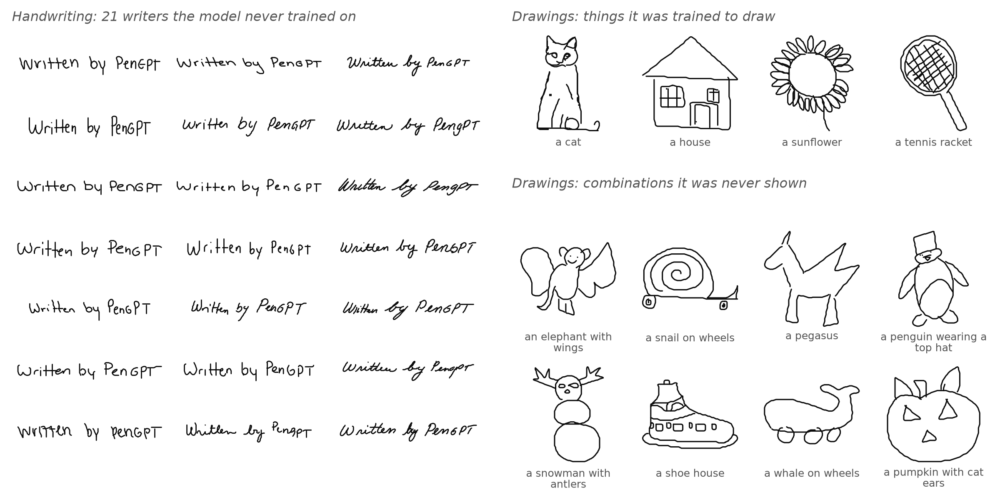

*Left: one phrase in the hands of 21 writers held out of training; the model read one to three real words by each and continued in
their hand. Right: drawings from typed prompts, the best third of the samples of each, chosen by eye; the bottom eight combine things
in ways that appear in none of the labels or captions it was trained on.*

PenGPT is a small transformer that holds a pen. It emits pen strokes one token at a time, the way a language model emits words, and
the same code trained on different data gives two models. The handwriting model (6M parameters, a 6 MB file) writes any text in
any of 1,192 hands, print or cursive, holds a hand steady over a page, and can pick up a new hand from a photo of a few words. The
drawing model (54M parameters, a 50 MB file) draws what a phrase describes, including things and scenes it was never shown, in the
manner of several kinds of drawing. Both run from one numpy file on a laptop, and the weights of both are open: they download
from this repository's release the first time they are asked for.

The paper is in [`paper/`](paper/). It asks where the performance comes from, with an ablation of each part of the recipe: data,
augmentation and training on several words by one writer at a time matter most, while pen-position features, BPE merges and, for
handwriting, model size matter little.

```bash
git clone https://github.com/greydanus/pengpt && cd pengpt
pip install numpy                                                    # all that writing needs
python inference/pen.py write "The quick brown fox" --writer sam     # 1. handwriting -> hand.svg, half a second
```

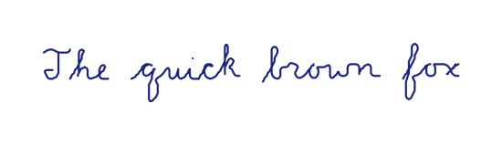

```bash
pip install -e ".[photo]"                                            # torch and the tools that read a photo
python inference/hand.py static/sample.jpg --out me                  # 2. fit a hand to a photo -> me.png, me.svg, me.npy
python inference/pen.py write "More text" --writer me.npy            #    and write anything in it
```

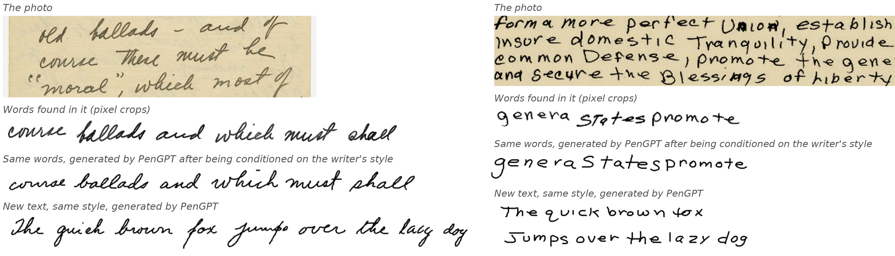

*What `hand.py` makes of two photos: part of the photo, some of the words it found there, the model's copy of them, and new text in
that hand. Left: a letter by the poet Sara Teasdale (`static/sample.jpg`; public domain, Missouri Historical Society). Right:
a paragraph one person printed on a NIST handwriting sample form in 1989 (`static/sample_print.jpg`; public domain, NIST Special
Database 19), tinted the colour of the letter's paper here so that it reads as a scan. `static/sample_hand.png` and `static/sample_print_hand.png` are the two figures as `hand.py` saves them, and
`tools/photo_hands.py` sets them side by side.*

```bash
pip install torch transformers                                       # only to turn typed words into what the model is told
python inference/pen.py draw "a rabbit|a castle" --n 4 --seed 2       # 3. drawings -> sketch.svg, three seconds each
```

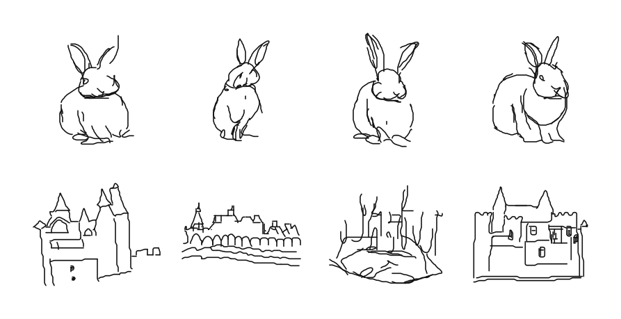

## Interpretability

What the two models learned, drawn by `python -m tools.interp` (`--only` picks which figures) from the trained checkpoints, `hand.pt`
and `sketch.pt` in the release (`pip install -e ".[interp]"` adds what it imports). The figures that score held-out examples also need
the data, which is not released.

**Where the pen goes next.** After each stroke of a cat, the chance that the next stroke inks each spot, from 128 sampled
continuations. Early on the next stroke could be the back, a leg or the face; later the choices narrow. The boxes below lay every
possible next token where it would land, weighted by its probability.

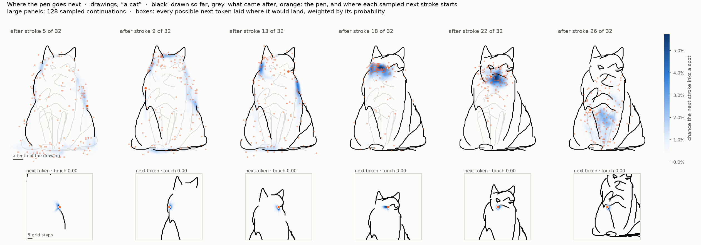

Handwriting is far more certain: the next 24 tokens follow nearly one path, the letters still to come.

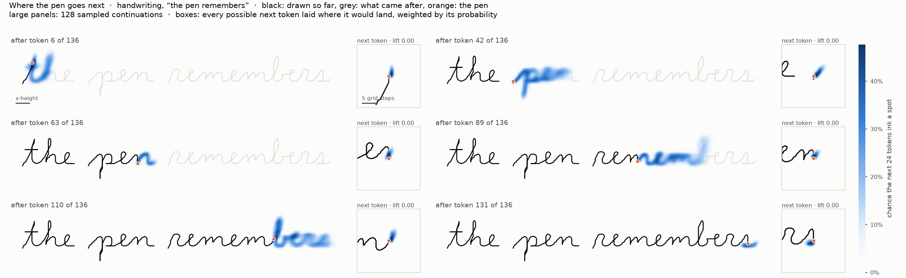

**Reading the letters.** The cross-attention heads of the handwriting model divide the text among themselves by position. One head
in layer 4 puts 81% of its attention on the letter being written, others read the next letter or both, and the rest read a wide
window. Silencing the head that reads the current letter costs more than silencing any other. A crossed t is read twice, once for
its stem and again for its cross. This figure is the paper's, drawn by `paper/figures/heads_plot.py`.

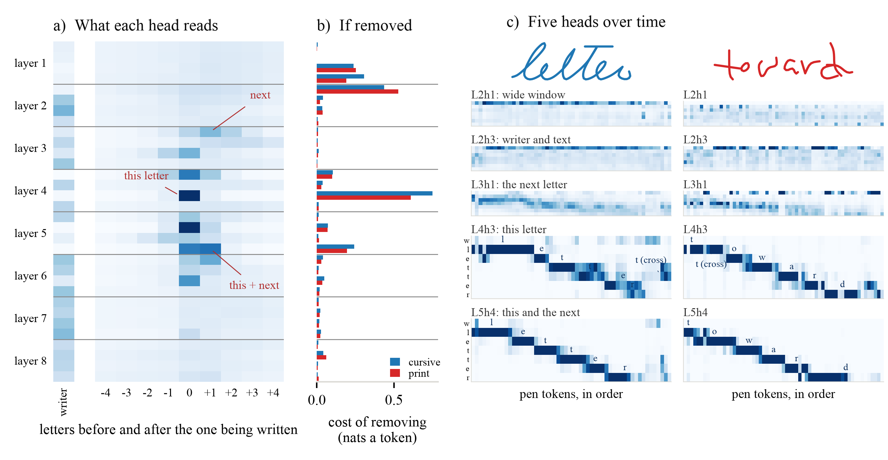

**Which heads matter.** Silencing one attention head at a time shows a handful carry most of the loss: in handwriting one
cross-attention head and two first-layer self-attention heads, in drawings two first-layer self-attention heads. Most of the rest
cost under 0.02 nats each.

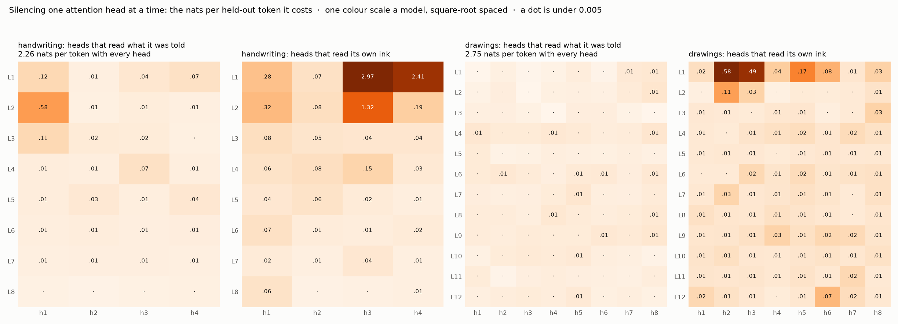

**How writers relate.** Every writer's learned vector, placed by UMAP and written as that writer's "hello": print on the left,
cursive on the right, the hands from archives along the bottom. Colour is where a writer's pages came from.

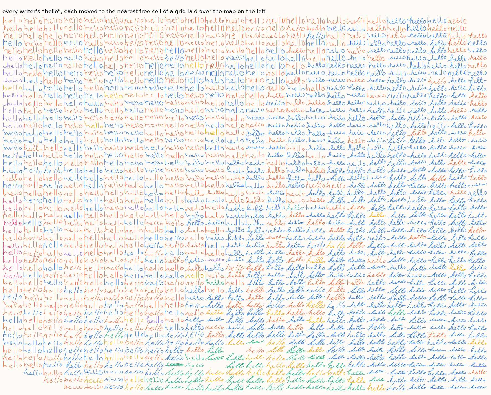

**How drawings relate.** Held-out drawings shown to the model with no prompt, placed by its own activations. They sort by source,
which is to say by how they are drawn; with each source's average taken away they sort by what they show.

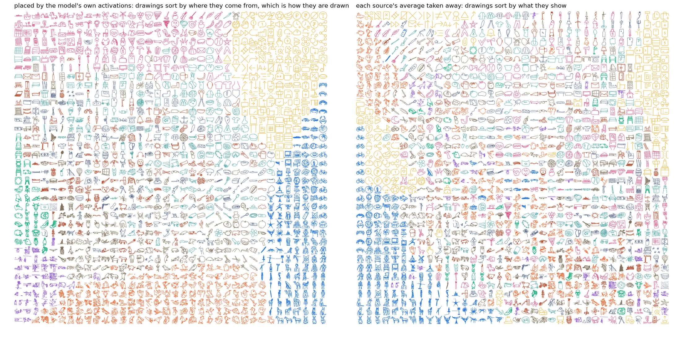

## Setup and training

**Writing** needs numpy alone: `pen.py` is one file that imports nothing else here. `python inference/pen.py write --writers` lists
the hands. In Python, `Pen("hand.npz").write(text, writer)` returns each word's points.

**Drawing** is numpy too. The words go through the text half of SigLIP 2 in `inference/words.py`, which is what needs torch, and a
375 MB download beside the model's 50 MB. `Pen("sketch.npz").draw("a cat")` returns a drawing's points; `--guidance`, `--ink` and
`--strokes` push a drawing towards its words, or ask for more or less of it.

**A hand from a photo.** `hand.py` boxes the words in a photo, has Claude read them, traces the clearest eight with InkSight, and
fits one style vector to the traces with the model frozen; the sampling temperature is set from how unpredictable the photo's ink is
to the model. About 10 seconds on a laptop for the letter above. It needs `ANTHROPIC_API_KEY` (in the environment or `.env`) and the
InkSight weights (Apache 2.0, 0.7 GB), which download from the release into `inksight/` the first time.

**Training.**

```bash
pip install -e ".[dev]"
pytest tests/
python pengpt.py train --profile m5                                  # handwriting on a laptop
python pengpt.py train --profile a100 --model sketch                 # drawings on one A100
python pengpt.py sample --checkpoint out/cursive/best.pt --greedy --text "The quick brown fox"
python pengpt.py sample --checkpoint out/quickdraw/best.pt --text "cat|bicycle" --n 8
```

The release also holds both models as trained, for the PyTorch code: `hand.pt` (24 MB) and `sketch.pt` (216 MB), the checkpoints
`hand.npz` and `sketch.npz` were packed from, with the same writer ids.

```bash
gh release download models-2026-11-16 --repo greydanus/pengpt --pattern "*.pt"
python pengpt.py sample --checkpoint hand.pt --writer sam --greedy --text "The quick brown fox"
python pengpt.py sample --checkpoint sketch.pt --text "a cat|a bicycle" --n 8
```

`--profile` names the machine and `--model` what to train; together they pick a recipe from `utils.py`, and any flag overrides it.

| `--profile` | `--model hand` | `--model sketch` |
|---|---|---|
| `cpu` | `cursive`, 4,000 steps, not compiled | Quick, Draw!, 4 layers, 128 wide, 2,000 steps (not measured) |
| `m5` | `cursive`: one writer, 400k parameters, about 6 minutes | Quick, Draw!, 8 layers, 256 wide, 6,000 steps (not measured) |
| `a100` | `mix`: seven sources, 5.2M parameters, 60,000 steps, 25 minutes | `quickdraw`: 12 layers, 384 wide, 28.9M parameters, 14,400 steps |
| `8xa100` | `mix` on eight GPUs, about 5 minutes; the released model adds `--n_embd 208 --steps 45000` (6.1M parameters) and takes about 8 minutes | `sketch`: every source, told SigLIP 2 vectors, 54M parameters, 18,000 steps, about 34 minutes: the released model, kept at step 16,500 (31 minutes) |
| `h100`, `8xh100` | as `a100` and `8xa100` | as `a100` and `8xa100` |


Each run writes `best.pt`, `last.pt`, `metrics.jsonl` and progress sheets to `out/<name>/`. Every evaluation logs training loss,
held-out loss, `word score` (nats per base pen move on each held-out example alone, which does not depend on the tokenizer, so it
is the number to compare runs by) and `text rank` (each of 16 examples scored under its own prompt and the other 15; 1 is perfect).
The released models score 0.711 (handwriting) and 0.588 (drawings), on the held-out examples their checkpoints were chosen by.
`--preset` names a recipe directly: `cursive`, `mix`, `quickdraw`, `sketch`, and the two controls of the ablations, `graves` (a
Graves-style LSTM) and `polar` (the Cursive Transformer's tokenizer).

`tools/train_cloud.sh` runs a plan (`tools/plan.txt`: a name and arguments a line) on a spot 8xA100 node of your Google Cloud
project (`PROJECT=...`) and pulls the results; `tools/gcp.sh` finds, watches and deletes the node.

## Data

The two models were trained on 495,590 handwritten words and 477,670 drawings. The datasets are not released; the paper's appendix
describes how they were built, and its data table names every source.

**Handwriting** is 1,255 writers from seven sources: two collections gathered for research (CSAFE and the CEDAR letter), letters and
diaries from the Internet Archive and the Library of Congress, study notes from public GitHub repositories, and the trackpad words
of the Cursive Transformer. Most of it began as scanned pages. Pages were cut into words, the words were read and traced back into
pen strokes, and what came out was checked and filtered hard: between a third and a half of the words survive. The model only ever
sees strokes, set on a common baseline at a common size.

**Drawings** come from ten sources, the largest being Quick, Draw!, Sketchy and TU-Berlin. Each source was scored for quality, and
of the 50 million drawings in Quick, Draw! the best 0.5% are kept. Every drawing was described in words in up to 17 ways. The model
is told a vector of one of those descriptions, or of the drawing itself.

To train on your own, a dataset is a Parquet file in one layout, read by `strokes.py`: one drawing or word a row, a `label`, and
five list columns for the strokes.

```python
from strokes import save_strokes
save_strokes([{"id": "me/0", "label": "hello", "writer": "me", "strokes": [[[0.0, 0.0], [0.01, -0.02]]]}], "data/mine.hand.parquet", unit=2e-3)
```

Handwriting has y pointing down, the baseline at y = 0, an x-height of 0.123 and points about 0.01 apart;
`python pengpt.py check --dataset data/mine.hand.parquet` checks a file and training refuses one that is off. A drawing is scaled so
its longer side is 1. Several files are pooled with `--dataset "a.hand.parquet:3,b.hand.parquet"`, where `:3` makes each of a
file's rows three times as likely.

## How it works

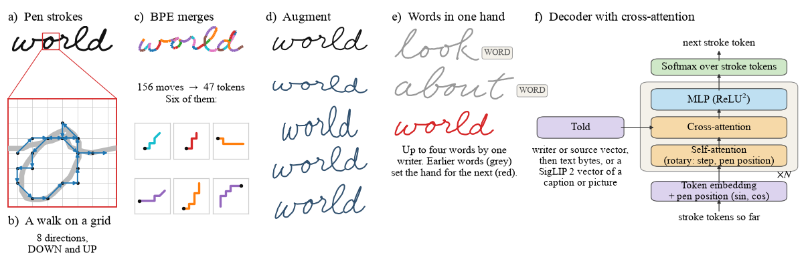

**Tokens.** Pen points are snapped to a grid and motion becomes a walk on it: eight compass directions plus `DOWN` and `UP`. BPE
merges common runs into single tokens, so one token is a short stroke. Handwriting learns 512 merges on a 0.02 grid; drawings share
1,024 merges on a grid of 80 cells (`data/sketch_tokens.json`).

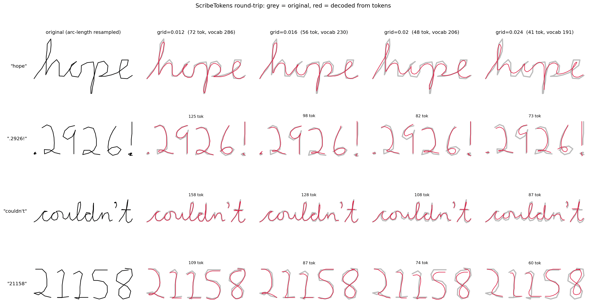

**Model.** A nanochat-style decoder: rotary positions, RMSNorm, QK-norm, ReLU² MLPs, no biases, a logit soft cap, and
cross-attention over what the model is told. Block matrices train with Muon and everything else with AdamW. It is told where its pen
is as sines and cosines of the pen's offset added to each token and, for drawings, as a rotary encoding in self-attention, so
strokes drawn near each other attend to each other.

**What it is told.** A short context beside the strokes. For handwriting it is the bytes of the text; for drawings it is a SigLIP 2
vector of the drawing's picture, label or caption, so at sampling a typed sentence stands in for any of them. Either way the context
starts with one learned vector for the source: the writer, or the dataset a drawing came from. Drawings are sometimes trained with
nothing told, which is what guidance at sampling pushes against.

**Long text** is written two words per call, each call continuing from the last word written, so the hand stays steady:

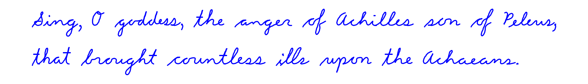

## Packing a model

```bash
python -m tools.pack --checkpoint out/mix8/best.pt --out hand.npz --bits 8  # 8 bits a weight: 5.8 MB
```

`tools/pack.py` gives each matrix 3 to 8 bits: it takes gradients of the loss on held-out data, weighs how far rounding moves each
weight by its squared gradient, and lowers the bits of whichever matrix costs least until the average is `--bits`. The released
models are packed at 8: the handwriting model is 5.8 MB and loses 0.001 nats a token; the drawing model is 50 MB and loses 0.003. At
the default of 7 they are 4.4 MB and 44 MB and lose 0.002 and 0.004. `pen.py` imports
nothing from the rest of the repository, so a packed model keeps working as the training code changes.

## Repo map

```
pengpt.py     tokenizer, data, model, training, sampling
utils.py      recipes: presets, and the best one for each machine
strokes.py    the dataset file format
vectors.py    reads the SigLIP 2 vectors a drawing model is told, and encodes typed words
graves.py     a Graves-style LSTM, the recurrent baseline
polar.py      the Cursive Transformer's polar tokenizer, for comparison
inference/    pen.py (both packed models, numpy only), words.py (typed words to a vector), hand.py and tracing.py (a photo to your hand)
tools/        pack.py, interp.py and figures.py (the figures above), hero.py (the first picture), photo_hands.py, styles.py (48 hands);
              ablate.py, transfer.py, legible.py, guidance.py and captions.py (the paper's measurements);
              train_cloud.sh, train_node.sh, gcp.sh, steptime.py
paper/        the paper: pengpt.tex, its figures and the numbers behind its tables (paper/README.md); render.sh builds the PDF
docs/         notes on the drawing ablations and the caption study
tests/        pytest
```

The cursive model and dataset come from the cursivetransformer project with Zachary Wimpee.
